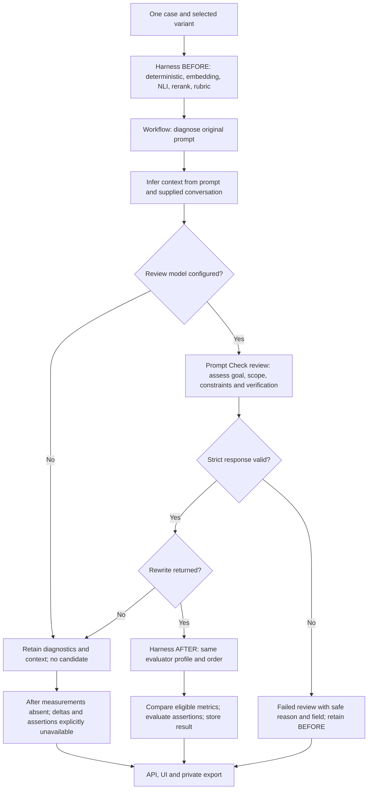
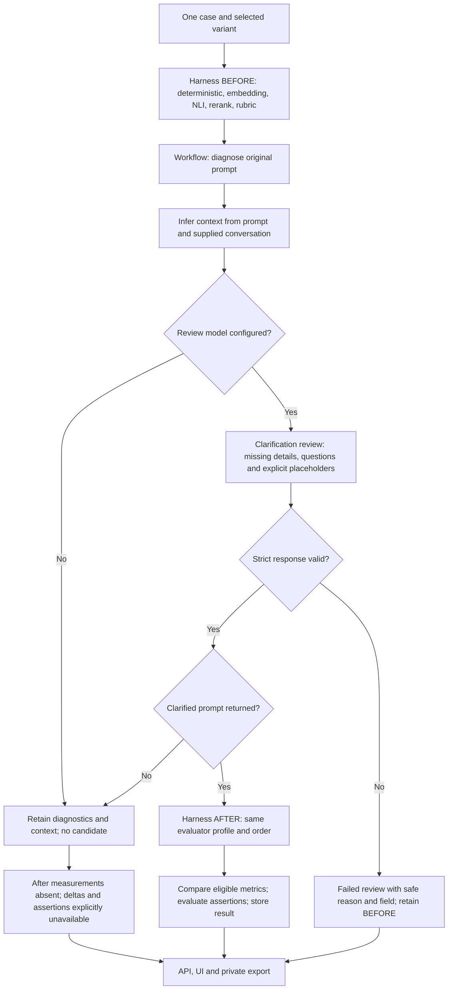
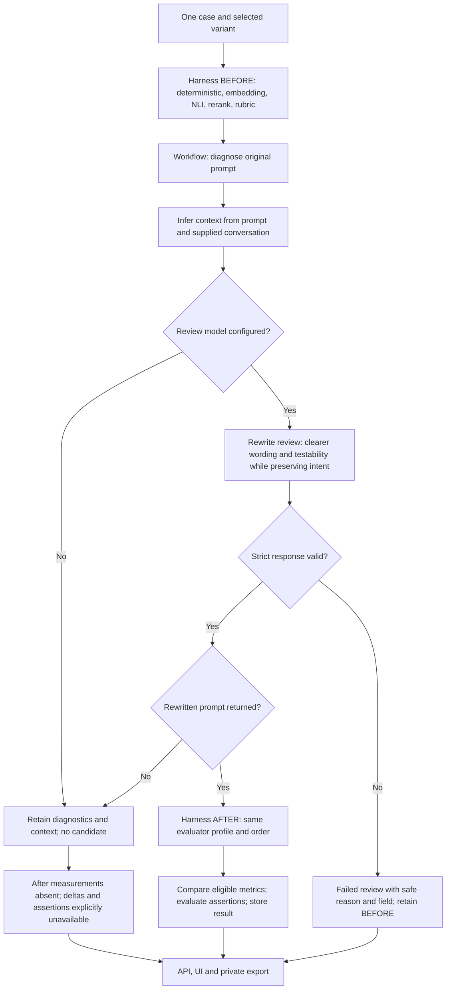

# Experiment flow and review diagnostics

## Release-gate compatibility repair - 2026-10-24

- Task / atlas: W02/W07; repair the synthetic API/storage/export contract test.
- Approved baseline: develop `e31ca18`, reviewed in #88 and promoted by #89.
- Reproduction: deployment `40126241241` and core publication `40126311234`
  stop at validation; the full Bench suite reports three failures and 409 passes.
  All failures expect the API response to equal the raw stored run, omitting
  the approved computed `continuation` field. No service replacement, image
  publication or core registration occurs in either failed workflow.
- Scope: the existing three-case integration test and its evidence records.
  Require exact stored-field equality plus explicit continuation metadata;
  verify that reading the API leaves storage unchanged. Check safe rejection
  reason/field across core HTTP, storage, inspection and JSON/CSV export.
- Evidence: the three repaired cases and the full 412-test Bench suite pass.
  Success permits independent work; failure with a skipped selection stops.
  Every case prohibits replay. Empty review reports `empty_review` at `reply`;
  a model failure has no fabricated validation detail.
- Remaining gates: owner-reviewed repair and promotion, fresh hosted validation,
  authorized core 0.3.6 publication, deployment and live qualification.
  Product behavior, core build inputs and acceptance statuses are unchanged.

## Task card - 2026-10-24

- Task / atlas: MA18, W02/W03/W05/W07; bounded prompt Bench handoff.
- Approved baseline: develop `2e76634`, after reviewed revision-4 definitions.
- Outcome: each experiment explains its actual selected variant, evaluator order,
  workflow and optional outputs; invalid reviews report a safe field and reason.
- Reproduction: a completed synthetic ACP response violates a nested review enum.
  Strict rejection works, but the recorded error identifies no offending field.
  A fail-fast qualification controller leaves independent cases uncovered.
- Scope: review validation diagnostics, core result schema, Bench inspection and
  private export, experiment/run diagrams, operation guidance and focused tests.
- Contracts: preserve strict acceptance, original results, workflow identities,
  model bindings, evaluator semantics and remote-stop/cleanup requirements.
- Candidate: core 0.3.6 for additive review diagnostics. Existing experiment
  artifact pins remain immutable; release and new pins require owner review.
- Evidence plan: synthetic invalid enums, hostile keys, missing fields, malformed
  JSON, compatibility, error export/CLI parity, continuation refusal, and all
  three experiment diagrams on desktop/mobile with revision/variant switching.
- Completion: reviewable source with bounded local evidence. Source/promotion
  approval, core publication, deployment, fresh live coverage and unaided
  onboarding remain separate gates.

## Reading the diagram

The experiment page draws the flow from its saved definition and matching
workflow manifest. Choose a variant to see its model binding, settings and
policy identity. Run pages use the frozen effective settings, including overrides.
The diagram describes planned wiring; recorded attempt receipts establish what
actually executed. It never calls a model.

Harness evaluators run sequentially in profile order before the workflow and,
when a valid candidate exists, again on that candidate. Their judgments do not
enter a versioned prompt workflow. The workflow computes its own diagnostics
and context before the optional review. The before/after pair is one attempt.

## Review rejection

Core 0.3.6 adds `workflow_result.review.validation_issue`: an allowlisted reason
and schema field path, such as `enum_mismatch` and
`reformulated_elements[1].element`. It contains no rejected value, raw response,
arbitrary key, validation message or provider diagnostic. Historical results
without this field retain an unknown detailed cause.

## The three robustness experiments

These diagrams describe revision 4's three definitions, each with 20 cases and
four variants (80 attempts). The live diagram reads the selected revision instead
of assuming these pins. The four variants are concise, structured, notes-only
and diagnostics-only. Notes-only requests no rewrite; diagnostics-only skips
model review. Each model-bound variant still passes the strict response parser.

### Prompt Check

`example-robustness-prompt-check-20261023`, workflow `prompt-check` 1.1.0.

### Prompt Clarify

`example-robustness-prompt-clarify-20261023`, workflow `prompt-clarify` 2.1.0.

### Prompt Rewrite

`example-robustness-prompt-rewrite-20261023`, workflow `prompt-rewrite` 2.1.0.

The harness's BEFORE scores do not enter any of these model review prompts.
Their workflow diagnostics and inferred context do. Uncertain transport or
unconfirmed cleanup holds subsequent work for reconciliation on every branch.
These diagrams describe response diagnostics available in the 0.3.6 candidate;
revision 4's pinned 0.3.5 records only the generic invalid-review code.

## Independent case continuation

Use one case and one variant per run for the next qualification cohort. Retain
every receipt and include failed attempts in coverage and outcome denominators.
Inspection's continuation decision applies to a new independent selection; it
never authorizes replay of the failed operation or declares the next model ready.
Preflight the next selection and verify the global queue/holds are clear.

Continue after a settled successful run or a confirmed completed invalid-review
failure. Stop for other technical failures, missing/contradictory evidence,
unsettled execution, timeout, cancellation, cleanup or reconciliation holds.
Quality assertions and explicitly unavailable metrics remain separate outcomes.

The existing worker keeps its fail-fast behavior within a run. One-pair runs
avoid skipping unrelated cases. An operator or controller must read the client's
`continuation` object after each terminal result: `continue_independent_case`
permits the next unsubmitted pair; `stop` requires inspection. `replayAllowed`
is always false. A skipped case remains uncovered until deliberately submitted.

New exports use `bench-analysis/v2`, adding nullable `validation_reason` and
`validation_field` columns to the errors table. The `bench-export/v1` manifest
identifies this analysis version and bundles its exact schema. Existing v1
artifacts are not rewritten; readers must use each export's bundled schema.

## Validation evidence

All 301 affected core tests and 229 distinct Bench tests pass. They cover strict
review acceptance and safe errors, all three workflows, contracts/adapters,
packaging, API/inspection/JSON/CSV parity, malformed and contradictory continuation
evidence, worker/storage recovery, the synthetic connected pipeline and artifact
release/resolution. The 38 desktop/mobile checks cover all three experiment
diagrams, variant and revision selection, frozen run settings, missing manifests,
historical unknown causes, stale-result recovery and metric states. An owned
loopback preview also confirms readable branch layout and variant switching.

No new core publication, deployment or live experiment is claimed by this source
candidate. The prior revision-4 live result remains partial and immutable.
