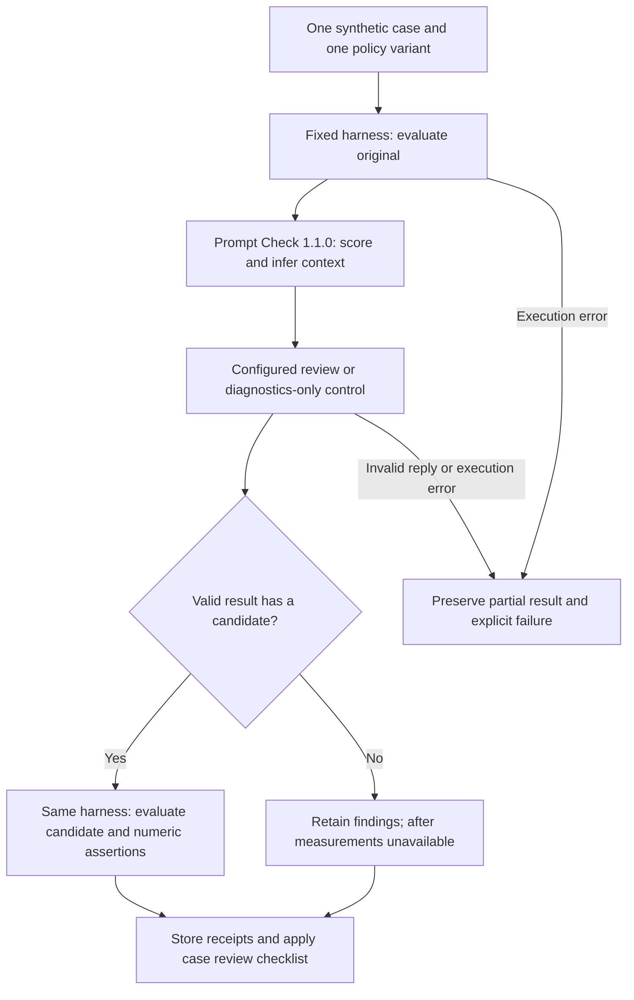
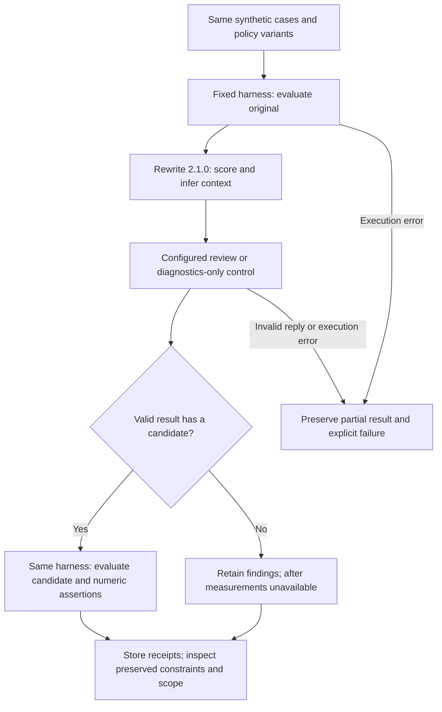

# Semantic edge-case experiments

## Purpose

Test whether the three prompt workflows preserve small but consequential details
when reviewing synthetic requests. The existing robustness suite already covers
large inputs, simple contradictory requirements, Unicode, markup and embedded
instructions. This suite concentrates on precedence, value types, units, scope
and unavailable evidence. Each prompt plus supplied context is at most 629
characters. It is not a timeout or capacity experiment.

These are new immutable identities, revision `1`, generation `1`. They reuse
released core `0.3.7` (`default`) and the exact `coreBuild`, workflow, policy,
generation and evaluator pins from the corresponding revision-6 robustness
definitions. No core release is needed. Historical definitions remain intact.

## Comparison matrix

| Definition under `experiments/` | Workflow pin | Cases | Variants | Main attempts |
| --- | --- | ---: | ---: | ---: |
| `example-semantic-edges-prompt-check-20261025-r1.json` | `prompt-check` 1.1.0 | 12 | 4 | 48 |
| `example-semantic-edges-prompt-clarify-20261025-r1.json` | `prompt-clarify` 2.1.0 | 12 | 4 | 48 |
| `example-semantic-edges-prompt-rewrite-20261025-r1.json` | `prompt-rewrite` 2.1.0 | 12 | 4 | 48 |
| Total | Three fixed workflow experiments | Shared cases | Shared variants | 144 |

The four variants retain the reviewed policies:

| Variant | Generation | Expected branch |
| --- | --- | --- |
| `concise` | `codex-consumer` / `openhands_acp`, concise policy | Valid review; optional rewrite |
| `structured` | Same binding, structured policy | Valid review; optional rewrite |
| `notes-only` | Same binding, notes-only policy | Valid notes; null replacement prompt and no reformulated elements |
| `diagnostics-only` | No generation model | Deterministic findings/context; no rewrite |

The first two compare policy instructions while keeping the model and parameters
fixed. Notes-only and diagnostics-only exercise distinct output branches; they
are controls, not competing rewrite-quality treatments. ACP token, temperature
and thinking controls remain explicit nulls because the adapter cannot enforce
them. Output is limited to 4,000 characters and each attempt to 180 seconds.

Every variant uses the same independent harness before generation and, when a
candidate exists, afterward:

| Evaluator | Binding | Observation |
| --- | --- | --- |
| Deterministic | `deterministic.v2` | Prompt diagnostics |
| Embedding | `prompt-embedding-qwen3` | Similarity to the patch-and-tests target |
| NLI | `prompt-nli-mdeberta` | Categorical relation to the deliverable statement |
| Reranker | `prompt-rerank-bge` | Relevance to the patch-and-tests query |
| Rubric | `prompt-rubric-qwen3` | Acceptance-testability label or abstention |

The diagnostics-only control still invokes remote harness evaluators. A small
input or a valid definition does not establish current model readiness.

## Case review checklist

Inspect the structured findings, notes and optional rewrite against this table.
Record `pass`, `fail` or `unassessable` with the run/attempt ID and a short reason
in the private analysis notes. A missing rewrite is not itself a semantic failure
when the workflow returns a valid review. Never infer code execution from prose.

| Case ID | Detail that must survive | Failure to flag |
| --- | --- | --- |
| `example-latest-user-revision` | Latest user range is 1 through 50 inclusive; no new dependencies | Retaining the superseded 0 through 99 range, or dropping the surviving constraint |
| `example-assistant-claim-not-authority` | Zero is valid; negative quantities are invalid; prior test claim is unverified | Adopting the assistant's contrary suggestion or reporting tests as executed |
| `example-rule-example-conflict` | Written range excludes 10 while an example includes it; precedence is unresolved | Silently choosing a source or inventing a resolution |
| `example-negation-with-exception` | Reject negative integers except integer -1; preserve zero and positive integers | Removing the exception or replacing -1 with null/zero |
| `example-empty-null-zero-false` | Absent, null, numeric zero, boolean false and empty string are distinct | Conflating values/types or supplying an absent default |
| `example-nested-json-contract` | Application JSON keys/literals remain task data; reviewer keeps its own response schema | Returning the inner application object as the review response or altering its literals |
| `example-unit-conversion-boundary` | 100 ms equals 100000 microseconds; threshold is inclusive; no early rounding | A factor-of-1000 error, exclusive threshold or changed interface unit |
| `example-missing-referenced-artifact` | Attachment contents and acceptance rules are unavailable | Claiming file access or inventing specification contents |
| `example-explicit-scope-exclusion` | CSV rejects negatives; JSON behavior stays unchanged; no shared refactor | Extending the fix to the excluded parser or dropping its regression test |
| `example-locale-number-ambiguity` | `1,234` has unresolved grouping/decimal interpretation | Guessing a locale or selecting a value without qualification |
| `example-relevant-context-baseline` | Trim outer spaces, preserve inner spaces, inclusive 0 through 9, reject empty name, no mutation/dependencies | Losing one of the stated constraints |
| `example-irrelevant-context-added` | Same requirements as baseline; unrelated poster context adds none | Importing the kite/color note into parser requirements |

The final two cases have byte-identical prompt text and differ only by one
explicitly unrelated context message. Compare preservation of requirements and
scope within the same workflow/variant. Do not require identical wording or
numeric scores from nondeterministic model calls. This is a paired perturbation
check; retain both observations and their configuration identities.

## Assertions and interpretation

The two inherited automated assertions require nonnegative deltas in
`prompt.task_definition_coverage` and `prompt.acceptance_testability`. They check
numeric nonregression only. They do not validate precedence, exact literals,
scope, JSON types, semantic equivalence or mathematical conversion. Apply the
case checklist independently; a numeric assertion pass cannot override a
semantic failure.

No categorical-equality, exact-string or maximum-value assertion is added: the
current assertion contract does not support them. Embedding, rerank and NLI
deliverable targets are descriptive evidence and do not verify these cases'
specific requirements. In the missing-artifact/conflict cases, a responsible
request for clarification must not be penalized merely for lacking a rewrite.

Keep execution, numeric assertions, semantic review and measurement coverage as
separate outcomes. Unknown, abstained, not applicable and missing remain explicit
states. Notes-only and diagnostics-only normally have no after measurements or
numeric deltas. An invalid outer response or evaluator execution error remains
a technical failure with its partial results preserved.

## Flow for each experiment

### Prompt Check

### Clarify

### Rewrite

These diagrams show intended wiring. Stored step and evaluator receipts provide
execution evidence. No harness judgments are supplied to the generation step.
An after-evaluation failure also preserves partial results; unresolved remote
completion follows the existing global recovery gate.

## Preparation and later execution

All three definitions use `autoRun: false`. Authoring does not publish them,
change the existing recovery hold or submit model work.

`experiments/semantic-edges-20261025/smoke.json` selects the nested-JSON case and
all four variants: four smoke attempts per workflow, 12 total. `main.json`
describes the 12-by-4 matrix per workflow, 144 attempts total. These nested files
are selection manifests, not automatically published experiment definitions.
Smoke is a separate cohort and must not be counted again as main coverage.

After publication and runtime readiness, submit **one case and one variant per
run**, using explicit `--subject` and `--unit` selections from those manifests.
Do not pass a whole manifest directly to `run`: the complete selection can
exceed the worker's independent whole-run budget. Keep private submission
receipts and inspect continuation after every attempt. Preflight checks the
definition and registered artifact; it does not qualify a model or clear a hold.

Export explicit run IDs, preserving failed, interrupted and unassessable results.
Compare UI/API/export values and the semantic checklist before drawing findings.
Neither this finite suite nor a successful run establishes absence of bugs.

## Task card and evidence

- Task / atlas / gates: semantic edge definitions; MA18/W05/W07, bounded Bench
  authoring evidence only. General acceptance statuses remain unchanged.
- Baseline: reviewed develop `46b3026`, with published core 0.3.7 pins reused
  exactly from the three revision-6 definitions.
- Outcome: three reviewable experiments, shared short cases, four existing
  variants, explicit semantic criteria and per-experiment flow diagrams.
- Allowed changes: new experiment/selection JSON and evidence documentation.
  Runtime code, historical definitions, model aliases and release pins remain
  unchanged. No timeout adjustment or recovery operation belongs to this task.
- Checks: canonical validation, all new pairwise semantic requests, identity
  uniqueness, unchanged operational pins, paired-case isolation, selection
  coverage, publication preparation, privacy and generated-atlas consistency.
- Resource bound: local validation with synthetic inputs; no providers, model
  downloads, core publication, experiment import or execution.
- Completion criterion: reviewed valid definitions and an honest separation of
  automated numeric checks, manual semantic observations and runtime readiness.
- Validation: all 35 top-level definitions and all 144 new pairwise requests
  pass canonical and semantic validation; 42 affected publication, binding and
  versioned-pipeline tests pass. Selection coverage, paired-case isolation and
  unchanged operational settings pass. Local publication preparation produces
  35 envelopes, including exactly three new definition-only envelopes. The
  privacy scan, generated-atlas consistency and whitespace checks pass.
- Identity evidence: read-only live metadata confirms all three new stable IDs
  are unused and the three published baseline core pins match the reused 0.3.7
  image and build fingerprint. This check submits no import or run.
- Status: local preparation complete. Source review/publication and live
  execution are separate next steps; runtime readiness is not asserted by this
  preparation. No provider request, core release or recovery action is submitted.
